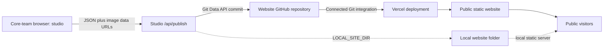

# MSA membership cards and public directory

This workspace contains two separate applications for MSA (Microsoft Student Ambassadors) SZABIST Islamabad:

- **Core-team members use `msa-card-studio/`** to design cards, edit photos, download images, and publish or manage members with an admin key.
- **Public visitors use `msa-szabist-website/`** to browse the member carousel and open membership profiles. It contains no administration interface.

There is no database, framework, bundler, or application build step. The public website's JSON, HTML, and image files are the persistent data. The studio writes those files locally during testing or commits them to the website repository in production.

These guides describe the source audited on **21 November 2026**. They document the current implementation, including its limitations, rather than earlier feature requests.

**Naming:** these guides use "MSA" everywhere, matching the project folders and the text on the cards. If "MLSA" still appears in code or other documents, it is an older spelling and should be corrected there.

| Guide | Read it for |
| --- | --- |
| [Studio technical guide](msa-card-studio/README.md) | Modules, rendering, APIs, validation, storage, data model, configuration, and security |
| [Website maintainer guide](msa-szabist-website/README.md) | Carousel, themes, generated profiles, hosting configuration, and manual corrections |
| [Troubleshooting](TROUBLESHOOTING.md) | Setup failures, publishing problems, confirmed code issues, and verification limits |

## Architecture at a glance



The studio backend does not call a Vercel deployment API. It changes the configured GitHub branch. Automatic deployment is a hosting integration that must be configured separately; a production-branch push can trigger the website deployment. See [Vercel Git deployment behavior](https://vercel.com/docs/git). A successful publish response confirms the file write or commit, not completion of a deployment.

## Why there is no database

Every member is stored as ordinary files inside the public website's own repository: one record in `data/members.json`, one generated page in `profile/<slug>/`, and a set of images in `assets/members/<slug>/`. The website simply serves those files. This was a deliberate choice for a small team directory.

**What this gives you**

- **Nothing extra to run or pay for.** There is no database server, no database account, and no extra secret to manage.
- **Easy to understand and inspect.** Anyone can open the files and see exactly what is published.
- **Free history and rollback.** Git records every change, so you can see who changed what and restore an earlier version.
- **Fast, cheap hosting.** The public site is plain static files, so it needs no server code to answer visitors.

**What it costs**

- **Changes are not instant.** A publish is a commit, and the public site only updates after the hosting platform deploys that commit, usually within a minute or two. The studio's success message confirms the commit, not the deployment.
- **Deleted data stays in Git history.** Deleting a member removes the current files, but the old commits still contain their name, photo, and images. Removing someone completely from history needs a separate, deliberate Git operation, so consider this before publishing anyone's photo and personal details.
- **The publishing token is powerful.** The GitHub token can change any file in the website repository, not just member folders. Keep it server-side, limit it to that one repository, and plan to rotate it.
- **The repository grows with every publish.** Each member adds several images, so the repository gets larger over time.
- **No locking between two people.** If two core-team members publish at nearly the same moment, their changes can collide, and one publish may fail and need to be repeated. Nothing in the code prevents this.
- **No server-side search or queries.** The browser downloads the whole member list and works with it, which is fine for dozens or a few hundred members but not for very large directories.

If the team grows large, needs instant updates, or needs to delete personal data permanently, a real database would be the next step. That would be a design change, not a configuration option.

## What is implemented now

| Operation | Current behavior |
| --- | --- |
| Wide card | `1080 × 1012` design; front only |
| Portrait card | `1080 × 1700` per side; front and verification back |
| Wide download | One front PNG, normally `3240 × 3036` |
| Portrait download | One PNG: **back left, front right**, with a transparent gap; normally `6672 × 5100` |
| Publishing | Always two Wide front themes, regardless of the preview layout or side |
| Verification backs | Portrait SVGs generated by the backend, with `@<slug>` and a real QR code |
| Public card display | Wide fronts only, switching between genuine Dark and Light PNGs |
| Social preview | A separate, always-dark `1200 × 630` PNG |
| Member management | Load, edit, create, and delete through authenticated endpoints |
| Description/bio field | **Not implemented**; metadata descriptions are generated from other member fields |

## Directory map

Paths below are relative to this workspace. Generated member folders are represented by `<slug>`; they are not source templates.

```text
.
|-- README.md                         # System overview and setup
|-- TROUBLESHOOTING.md                # Diagnostics and code-review findings
|-- msa-card-studio/                  # Private editor and publishing backend
|   |-- AGENTS.md                     # Contributor rules
|   |-- README.md                     # Detailed studio documentation
|   |-- .env.example                  # Blank/example production settings; no local-mode example
|   |-- .gitignore                    # Excludes credentials, .vercel, node_modules
|   |-- package.json                  # ES modules, Node >=18, npm run dev
|   |-- vercel.json                   # Privacy headers; publish function duration
|   |-- index.html                    # Editor, front/back preview DOM, photo dialog
|   |-- assets/
|   |   |-- css/
|   |   |   |-- studio.css            # Workspace UI, responsive layout, photo editor
|   |   |   |-- card.css              # Front artwork, social image styles, card-only wordmark
|   |   |   `-- brand.css             # Interface badge proportions
|   |   |-- img/                      # Supplied badges, Logo.png, SZABIST logo, legacy assets
|   |   |-- js/
|   |   |   |-- main.js               # Initializes the browser modules
|   |   |   |-- state.js              # Shared editor state and design dimensions
|   |   |   |-- utils.js              # DOM, text, slug, image, download helpers
|   |   |   |-- card.js               # Text binding, themes, layout/side selection, preview fit
|   |   |   |-- handles.js            # Social-handle parsing and Wide footer fitting
|   |   |   |-- editor.js             # Photo crop, pointer/wheel controls, filters
|   |   |   |-- export-photo.js       # Aspect-preserving photo crop for export clones
|   |   |   |-- export.js             # html2canvas rendering and merged Portrait PNG
|   |   |   |-- social.js             # Builds the separate social-preview image
|   |   |   |-- publish.js            # Browser-side publish payload and response handling
|   |   |   |-- publish-protocol.js   # Client/server capability version
|   |   |   |-- members.js            # Load, edit, delete, and new-member controls
|   |   |   |-- studio-ui.js          # Preview labels and download captions
|   |   |   |-- back.js               # Fetches verification URL settings; updates back preview
|   |   |   |-- verification.js       # Profile URL, QR matrix, self-contained Portrait back SVG
|   |   |   |-- corner-design.js      # Shared corner geometry
|   |   |   `-- dots.js               # Draws front dot decorations from that geometry
|   |   `-- vendor/
|   |       |-- fontawesome/          # Core/brands CSS, WOFF2 font, upstream license
|   |       `-- qrcode/               # MIT QR encoder, license, source note
|   |-- api/
|   |   |-- publish.js               # Authenticated create/update
|   |   |-- members.js               # Authenticated member list and protocol version
|   |   |-- member.js                # Authenticated single member plus editable photo
|   |   |-- delete.js                # Authenticated removal
|   |   `-- site.js                  # Public SITE_URL configuration only
|   |-- lib/
|   |   |-- api.js                   # Method/configuration/authentication checks and errors
|   |   |-- validate.js              # Member, slug, image, and request validation
|   |   |-- storage.js               # Active local/GitHub storage adapter
|   |   |-- github.js                # GitHub reads, tree listing, Git Data API commit
|   |   |-- profile-page.js          # Public profile HTML template
|   |   `-- local.js                 # Legacy local helpers; not used by active handlers
|   `-- scripts/
|       |-- dev-server.js            # Local HTTP server and .env loading
|       |-- api-runner.js            # Fresh API worker per local request
|       |-- test-members.js          # Temporary-folder CRUD and error checks
|       |-- test-github.js           # Handle validation and profile escaping checks
|       |-- test-export-photo.js     # Photo crop geometry checks
|       `-- test-verification.js     # QR URL, SVG, and public settings checks
`-- msa-szabist-website/              # Public static site; no package.json
    |-- AGENTS.md                    # Contributor rules
    |-- README.md                    # Maintainer documentation
    |-- .gitignore                   # Tool/OS artifact exclusions
    |-- index.html                   # Home shell; loads carousel.js
    |-- 404.html                     # Static missing-page/profile recovery screen
    |-- robots.txt                   # Allows crawling
    |-- vercel.json                  # Clean URLs, cache/security headers
    |-- serve.json                   # Local serve configuration; disables directory listings
    |-- data/members.json            # Ordered member records
    |-- profile/<slug>/index.html    # Generated public membership page
    `-- assets/
        |-- css/
        |   |-- base.css            # Shared public palette, theme controls, ambient background
        |   |-- brand.css           # Badge proportions
        |   |-- home.css            # Home header and introduction
        |   |-- carousel.css        # Card sizes, edge fades, controls, responsive stage
        |   |-- profile.css         # Member layout, dialog, downloads, reveal animation
        |   `-- not-found.css       # 404 layout and recovery search
        |-- js/
        |   |-- carousel.js         # Active continuous member carousel
        |   |-- directory.js        # Unused legacy team/avatar grid
        |   |-- theme.js            # Saved theme and real image switching
        |   |-- profile.js          # Dialog, copy link, photo fallback, reveal enhancement
        |   `-- not-found.js        # 404 heading, history button, member search
        |-- img/                    # Public badge/favicon assets and retained legacy logos
        |-- vendor/fontawesome/     # Separate public CSS/font/license copy
        `-- members/<slug>/         # Generated fronts, backs, social image, optional photo
```

The `profile/` and `assets/members/` roots also contain `.gitkeep` placeholders. Neither project currently contains `CODEX_TASK.md`. A local `.env.local` may exist but is not a repository asset and must never be committed.

## What happens when I click Publish member

1. `assets/js/main.js` has already initialized `initCard()`, `initEditor()`, `initDownload()`, `initPublish()`, `initMembers()`, `initStudioUI()`, `initBack()`, and the corner decorations.
2. The click handler in `initPublish()` reads the fields. `fieldValue()` drops bracketed placeholders; `slugify()` finalizes the profile username; `validateGithub()` checks GitHub; `linkedinUrl()` constructs a candidate LinkedIn URL. The selected card theme becomes `member.theme`.
3. The browser sends authenticated `GET /api/members` (handled by `api/members.js`, not by the publish handler) and compares `publishVersion` with `PUBLISH_VERSION`, currently `profile-themes-qr-v3`. An outdated server stops the upload.
4. `photoAsJpeg()` converts the current edited photo to JPEG with its longest edge at most 1000 pixels. `renderSocial()` builds the `1200 × 630` social image off-screen.
5. `renderCard(scale, 'wide', theme)` renders the selected theme and its opposite. It uses the Wide front explicitly, even if Portrait Back is on screen. `prepareExportPhotos()` bakes the photo's cover crop into the clone. Export waits for fonts and uses html2canvas.
6. The browser tries publish scales `1.5`, `1`, and `0.75`. It sends JSON containing `publishVersion`, `mode`, `member`, and data URLs in `files.photo`, `files.card`, `files.cardAlternate`, and `files.social`. No Portrait-front, merged-sheet, or back image is uploaded.
7. `api/publish.js` calls `setup()` in `lib/api.js`, then `checkPublishSize()`, `cleanMember()`, `members()`, and `decodeImage()`. It rejects an existing slug in create mode or a missing slug in update mode.
8. The handler preserves the existing `id` and `issued` when updating. Otherwise `newId()` creates an ID and `issued` is set. It calculates `assetVersion`, generates `profileHtml()`, and builds both Portrait-back themes through `profileUrl()` and `cardBackSvg()`.
9. `storage(cfg).commit()` writes the files. Local mode writes into `LOCAL_SITE_DIR` with best-effort rollback; production uses `commitFiles()` to create blobs, a tree, a commit, and update the GitHub branch reference.
10. The API returns `{ ok, id, cardThemes, publishVersion, url }`. The browser shows the profile URL and dispatches `members-changed` to refresh its member list. In production, the configured Git integration can now deploy the changed website branch.

```mermaid
sequenceDiagram
    actor Team as Core-team member
    participant Browser as Studio browser
    participant Members as api/members.js
    participant API as api/publish.js
    participant Store as storage(cfg)
    participant GitHub as Website repository
    participant Vercel as Website Git integration
    Team->>Browser: Publish member
    Browser->>Members: GET /api/members (preflight, x-admin-key)
    Members-->>Browser: Members and publishVersion
    Browser->>Browser: Render Wide themes, social image, photo
    Browser->>API: POST member + image data URLs + x-admin-key
    API->>API: Authenticate, validate, generate profile and Portrait backs
    API->>Store: Read directory / list existing assets
    alt LOCAL_SITE_DIR configured
        Store->>Store: Write local files, restore old contents on failure
    else GitHub storage
        Store->>GitHub: Read branch head; create blobs, tree, commit; PATCH ref
        GitHub-->>Vercel: Branch change through configured integration
    end
    Store-->>API: Write/commit complete
    API-->>Browser: 200 + profile URL
    Note over Browser,Vercel: The response does not wait for deployment completion
```

For exact filenames, response examples, and validation order, see the [studio API and data model](msa-card-studio/README.md#api-reference).

## What a visitor sees

1. `index.html` loads `theme.js` before CSS and `carousel.js` after the page markup.
2. `carousel.js` fetches `/data/members.json` without using the browser cache and keeps the array order. New records are prepended by publishing; updates retain their array position. The carousel does not sort by timestamps.
3. Each slide displays the member's Wide PNG. The active card grows toward the center; scrolling, dragging, arrows, keyboard controls, and pagination all use the same continuous animation state. Clicking a centered card opens `/profile/<slug>`.
4. That URL serves generated static HTML from `profile/<slug>/index.html`. It does not run a database lookup. Public themes switch actual Dark/Light card files when available.
5. Sharing a profile URL exposes its static Open Graph/Twitter metadata. The preview references the separately rendered `social.png`; a social crawler needs a reachable public URL, not localhost.
6. Scanning a Portrait QR opens the same profile URL. It has no timer, signature, or expiry service. Deleting the profile removes the current public record; the QR itself remains a URL.

## Quick start: Windows PowerShell

### 1. Prerequisites

- Keep the two project folders beside one another.
- Install Node.js and npm. The package declares Node `>=18`; this audit used Node `v24.21.0`, npm `11.19.0`, and `serve` `14.2.8`. Use a Node version supported by your deployment platform as well.
- The studio has no npm dependencies to install. Internet access is needed for html2canvas from cdnjs and the Google Fonts stylesheet. `npx` may download the static server on first use.
- Do not open either application as `file://`; use HTTP servers.

### 2. Configure local file storage

From the workspace root:

```powershell
Set-Location .\msa-card-studio
# Only copy when creating this file for the first time; do not overwrite existing settings.
Copy-Item .env.example .env.local
notepad.exe .env.local
```

For local testing, use these entries. Replace the key placeholder with a private value and enter that same value in the editor:

```dotenv
ADMIN_KEY=YOUR_ADMIN_KEY
SITE_URL=http://localhost:8000
LOCAL_SITE_DIR=../msa-szabist-website
PORT=3000
```

`LOCAL_SITE_DIR` selects local storage, so GitHub credentials are not required in this mode. The development server resolves this relative path against the studio folder. These writes affect the real sibling website folder; use a disposable copy if you do not want sample members in it.

The loader reads `.env` and then `.env.local`, with later values replacing earlier ones. Restart the process after changing configuration. **Do not put real credentials in `.env.example`, README examples, or source control.** See [local-server security findings](TROUBLESHOOTING.md#confirmed-code-issues) before exposing the development server to a network.

### 3. Run both servers

First PowerShell terminal, in `msa-card-studio/`:

```powershell
node scripts/dev-server.js
```

Open `http://localhost:3000`. `npm run dev` runs exactly the same Node command. If PowerShell blocks `npm.ps1`, use the direct Node command above or `npm.cmd run dev`; changing system execution policy is unnecessary.

Second terminal, from the workspace root:

```powershell
Set-Location .\msa-szabist-website
npx serve -l 8000
```

If `npx.ps1` is blocked, use:

```powershell
npx.cmd serve -l 8000
```

Open `http://localhost:8000`. Keep both terminals running; use `Ctrl+C` to stop them. Do not use `serve -s`, which turns missing routes into home-page responses.

### 4. Exercise the workflow

1. Enter a real name, team, role, optional social handles, and profile username.
2. Upload a photo, adjust the crop/filters, and click Apply. Choose Dark or White and Wide or Portrait.
3. Download Wide for a front PNG, or Portrait for the combined front/back sheet. Portrait downloads need a valid `SITE_URL` and username even before publishing.
4. Enter the admin key and click Publish member. Check `data/members.json`, `profile/<slug>/index.html`, and `assets/members/<slug>/` in the website folder.
5. Refresh the website, open the profile, and test both public themes. Use Load members and Edit member to update it. Delete removes its record and generated files.
6. Local changes do not deploy anything. To test on another device, use a reachable website address; `localhost` on a phone means the phone itself.

### 5. Run the included checks

From `msa-card-studio/`:

```powershell
node scripts/test-members.js
node scripts/test-github.js
node scripts/test-export-photo.js
node scripts/test-verification.js
```

There is no `npm test` script. The member test writes to a temporary folder, uses synthetic image signatures, and removes its fixture. It is not a substitute for testing real rendered PNGs or production GitHub access.

## Deployment guide

These are setup instructions derived from the repository and the linked platform documentation. No live GitHub account, token permissions, Vercel settings, or production deployment was inspected during this audit.

### 1. Prepare the repositories

Create a separate private GitHub repository for each project. Put each project at its own repository root and make an initial commit, including the website's `data/members.json`, static assets, and page files. The target website branch must already exist; the publisher cannot initialize an empty repository. Repository privacy does not make a deployed website private.

### 2. Deploy the website first

Import the website repository into Vercel. Set Framework Preset to **Other**, override the Build Command with an empty value, and serve the project root (`.`). There is no `public/` output folder or build command in this project. See [Vercel static build configuration](https://vercel.com/docs/builds/configure-a-build).

Connect the intended production branch, usually `main`, and note the final public domain. Confirm the home page, JSON, a sample generated profile, card images, and an unknown profile URL. Confirm unknown profiles return HTTP 404 and directory listings are disabled in the live deployment; `serve.json` only configures the local server.

### 3. Create a restricted publishing token

In GitHub, open Settings → Developer settings → Personal access tokens → Fine-grained tokens. Select the resource owner, an expiration policy, **Only select repositories**, and the website repository only. Grant repository **Contents: Read and write**; obtain organization approval if required. Do not grant access to the studio repository. See [GitHub's token setup instructions](https://docs.github.com/en/authentication/keeping-your-account-and-data-secure/managing-your-personal-access-tokens) and [endpoint permission requirements](https://docs.github.com/en/rest/authentication/permissions-required-for-fine-grained-personal-access-tokens).

The token can change contents throughout the selected repository, not just member folders. Keep it server-side and plan for expiration/rotation. Branch protection or organization policy may still prevent direct commits.

### 4. Deploy the studio separately

Import the studio repository into another Vercel project, also using **Other**, an empty Build Command, and the repository root as output. Vercel runs the `api/*.js` functions; `scripts/dev-server.js` is a local development server, not the production start command.

Set these server environment variables in the studio project, then redeploy:

```dotenv
ADMIN_KEY=YOUR_ADMIN_KEY
GITHUB_TOKEN=YOUR_FINE_GRAINED_TOKEN
GITHUB_REPO=YOUR_OWNER/YOUR_WEBSITE_REPOSITORY
GITHUB_BRANCH=main
SITE_URL=https://members.example.org
```

Do not configure `LOCAL_SITE_DIR` in production. No environment variables are needed by the public static application. For Preview environments, deliberately choose a test repository/branch and matching `SITE_URL`; copying production publishing credentials into previews also gives them production write access.

### 5. Connect deployment behavior and protect the editor

Set the website project's production branch to the same branch as `GITHUB_BRANCH`. A commit reaching another branch may produce only a Preview deployment. Automatic deployment depends on the Vercel Git integration and permissions, not code in either application. See [Vercel's GitHub integration](https://vercel.com/docs/git/vercel-for-github).

Enable suitable deployment access protection for the studio if available in your account. The implemented admin key protects member API calls, not the editor page itself. `noindex` headers discourage indexing; they do not authenticate visitors.

### 6. Check the first real publish

1. Confirm an unauthenticated member-list request is rejected, and `/api/site` reveals only the intended public website URL.
2. Publish a disposable member. Confirm the configured website repository receives one commit containing its profile, assets, and updated JSON.
3. Wait for that commit's website deployment to finish. The browser's “about a minute” success message is not a timing guarantee.
4. Check the carousel, both card themes, profile social links, and profile Open Graph image URL.
5. Download the Portrait sheet and scan its QR from another device. Confirm it opens the public profile rather than localhost or the studio.
6. Edit and delete the sample; verify the corresponding commits/deployments and a real 404 after deletion. Review [known limitations](TROUBLESHOOTING.md#limitations-for-maintainers) before routine use. Remember that a deleted member's files remain in Git history (see [Why there is no database](#why-there-is-no-database)).

## Audit verification

The documentation audit used an isolated copy with a temporary website folder and a dummy admin key. It exercised real browser photo upload/filtering, publishing with Portrait selected, both Wide theme files, a merged Portrait export, profile/404 serving, editing with preserved identity/date, and deletion. The sample produced eight asset files plus profile HTML and the directory JSON; one measured publish request was 967,911 bytes. No real website members, secrets, or application sources were changed by this audit.

Platform deployment behavior was checked against official documentation; actual cloud configuration and device-camera scanning were not tested in this documentation task. Confirmed issues and verification boundaries are recorded in [Troubleshooting](TROUBLESHOOTING.md).